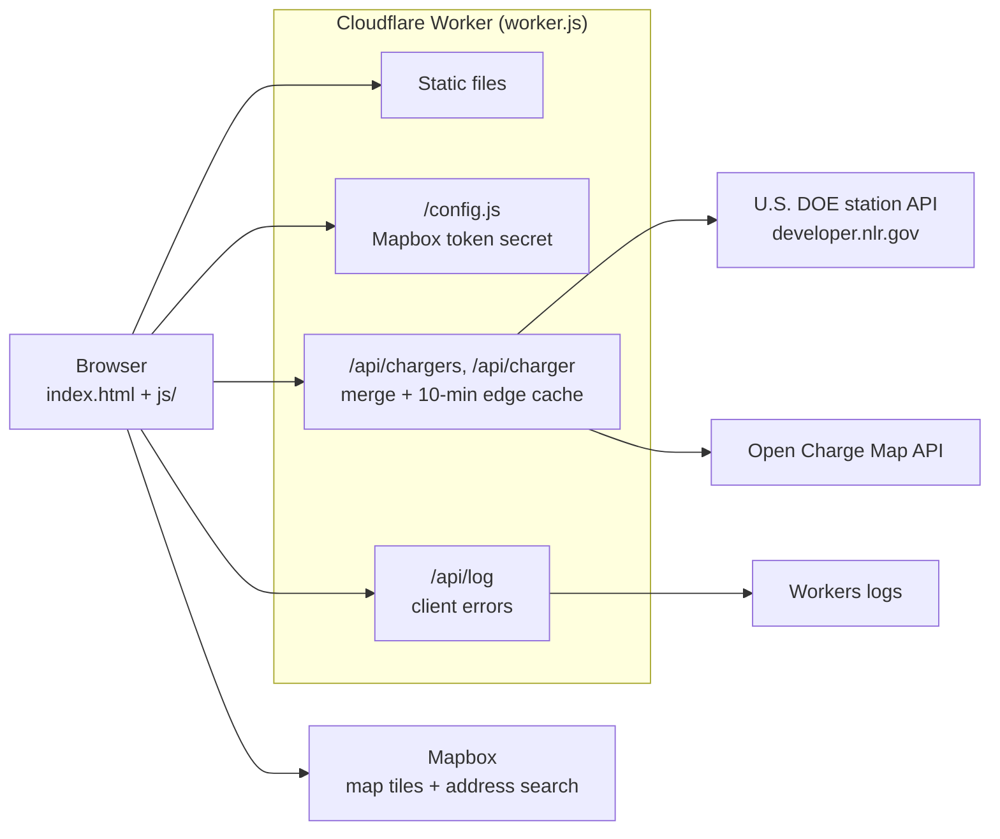

<p align="center">
  <a href="https://chargenear.org">
    <h2>
      <strong>ChargeNear.org</strong>
    </h2>
  </a>
</p>

[](https://chargenear.org)


# ChargeNear
An interactive, open-source map for hotels and Airbnb hosts to display nearby EV chargers, helping attract electric vehicle-owning guests.

## Features
- Defaults to the user's current location (with permission), falls back to Seattle, WA if denied.
- Advanced filtering options:
  - Charger Types: Level 2 and Level 3 (DC Fast) chargers
  - Network Providers: Tesla Superchargers, Tesla Destination, ChargePoint, Electrify America, EVgo, Blink, Volta, Shell Recharge, EV Connect, and SemaConnect
  - Charger Status: Operational only
  - Power Output: High power (150kW+), Medium power (50-150kW), Low power (<50kW)
  - **Chargers Nearby**: Display a transparent yellow circle showing walking distance options (5 min walk, 15 min walk, 1 mile) - perfect for property owners to showcase nearby charging options
- Custom markers with color coding:
  - Green for operational chargers
  - Light orange for high-power chargers
  - Brown for non-operational chargers
- Built with Mapbox GL JS and the Open Charge Map API.
- Responsive design that works well on both desktop and mobile devices.

## Why It's Useful
Hotels and Airbnb hosts can embed this map on their websites to:
- Showcase nearby public EV chargers, even if they don't have on-site charging.
- Display walking distance circles to highlight convenient charging options within 5-15 minute walks.
- Appeal to the growing number of EV drivers, boosting bookings.
- Provide a free, interactive tool that enhances guest convenience.
- Allow guests to filter chargers based on their specific needs (e.g., Tesla Superchargers, high-power chargers).

## How to Embed on Your Website
This tool is **free to use** and open-source! The easiest way is the embed builder at [chargenear.org/about#hosts](https://chargenear.org/about#hosts), which previews the map for your address and gives you the code to copy. Or embed it manually in two ways:

### Option 1: Embed with a Specific Address
Copy this iframe code into your website's HTML, replacing the address with your property's:
```html
<iframe src="https://Chargenear.org/?address=123+Main+St,+Austin,+TX" width="800" height="600" frameborder="0" style="border:0;" allowfullscreen></iframe>
```

### Option 2: Embed with Current Location
Copy this iframe code into your website's HTML:
```html
<iframe src="https://Chargenear.org" width="800" height="600" frameborder="0" style="border:0;" allowfullscreen></iframe>
```

### Customization Tips
- Adjust width and height in the iframe to fit your site's layout.
- Add URL parameters for defaults:
  - ?address=123+Main+St,+Austin,+TX to set a specific address
  - ?fastOnly=true to show only fast chargers
  - Example: https://chargenear.org?address=123+Main+St,+Austin,+TX&fastOnly=true

### Architecture


- **U.S. DOE** stations are the primary source in the U.S. and Canada; **Open Charge Map** adds community listings DOE doesn't have and covers the rest of the world (`stations.js` does the merge and removes duplicates).
- API keys (`MAPBOX_TOKEN`, `OCM_API_KEY`, `NREL_API_KEY`) are Worker secrets, never in the repo.
- Pushing to `main` deploys through Cloudflare Workers Builds.

## Setup for Developers
1. Clone the repo:
```bash
git clone https://github.com/hgottipati/ChargeNear.git
```
2. Put your keys in `.dev.vars` (gitignored). The Mapbox token is required; the Open Charge Map key is optional but recommended:
```bash
cat > .dev.vars <<'VARS'
MAPBOX_TOKEN=pk.your-mapbox-public-token
OCM_API_KEY=your-open-charge-map-key
NREL_API_KEY=your-nlr-developer-key
VARS
```
   Restrict the Mapbox token to your domains in your Mapbox account.
3. Run the same Cloudflare Worker setup as production (requires Node.js):
```bash
npx wrangler dev         # http://localhost:8000
```

The Worker (`worker.js`) serves the static files, generates `/config.js` from the `MAPBOX_TOKEN` secret, and merges U.S. DOE stations (developer.nlr.gov) with Open Charge Map through `/api/chargers` with edge caching, so no keys live in the repo.

## Deployment
Pushing to `main` deploys automatically through Cloudflare Workers (configured in `wrangler.jsonc`). Files listed in `.assetsignore` are not published.

## Demo
* Production version: https://chargenear.org 

## License
Free to use under the MIT License—see LICENSE for details.

## Future Enhancements
- Add real-time availability data
- Support custom marker uploads
- Add more detailed charger information
- Implement user preferences saving
